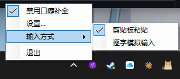
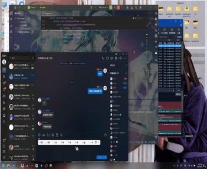

# ⌨️ Desuwa - ですわ

<div align="center">


**💬 全自动口癖添加工具 - 按下回车自动发送口癖 (WinUI 3 Fluent UI 升级版)**

[](https://dotnet.microsoft.com/)
[](https://github.com/VincentZyuApps/Desuwa/releases)

[](https://github.com/VincentZyuApps/Desuwa/commits/main)
[](https://github.com/VincentZyuApps/Desuwa/actions/workflows/build.yml)
[](https://github.com/VincentZyuApps/Desuwa/releases)

</div>

## 🚀 简介

Desuwa 是一个现代轻量级的 Windows 系统托盘工具，可以在你按下回车键时自动在文本末尾添加自定义口癖（如"ですわ"、"喵"、"desu"等），让你的聊天更有个性！

在 **v3.0.0** 中，Desuwa 全面升级至 **WinUI 3 (Windows App SDK) + Fluent UI** 架构，从右下角托盘菜单到设置主面板全面接入 Windows 11 原生 Mica（云母）材质与流体设计语言！

### ✨ 主要特性

- 🎨 **100% Win11 Fluent UI** - 托盘右键菜单采用原生 `MenuFlyout`，亚克力半透明、圆角阴影一应俱全
- 🪟 **Mica 现代设置窗口** - 原生卡片式设置布局，深浅主题自适应
- 🎯 **全局键盘钩子** - 监听所有应用的回车键
- 🔄 **自动文本追加** - 智能在文本末尾添加口癖并发送
- 🧠 **双输入模式** - 支持"剪贴板粘贴 (推荐)"与"底层 SendInput 逐字模拟输入"两种方式
- ⌨️ **全局快捷键** - 默认 `Alt+F10` 启用/禁用，`Alt+F11` 切换输入方式
- 🎨 **状态托盘图标** - 启用/禁用状态自动切换不同托盘图标
- 💾 **配置持久化** - 配置自动保存到程序目录下的 `settings.json`
- 🔇 **后台静默运行** - 单实例互斥保护，启动默认最小化到系统托盘，不占用任务栏

## 📸 预览图片

#### 🐛 起因：B站评论区


### 🖱️ 托盘菜单与界面



### 🎬 演示动画



## 📥 下载安装

### 📥 方式一：下载预编译版本（推荐）

前往 [Releases](https://github.com/VincentZyuApps/Desuwa/releases) 页面下载最新版本：

| 版本 | 下载 | 压缩 | PDB | 体积 | 场景 |
|------|:----:|:----:|:---:|:----:|------|
| **📦 Self-contained** | [](https://github.com/VincentZyuApps/Desuwa/releases) | ✅ zip | ❌ stripped | ~60MB | 开箱即用免运行环境 |
| **🧩 Runtime-dependent** | [](https://github.com/VincentZyuApps/Desuwa/releases) | ✅ zip | ❌ stripped | ~15MB | 已装 .NET 10 用户 |
| **🐛 Debug** | [](https://github.com/VincentZyuApps/Desuwa/releases) | ✅ zip | ✅ portable | ~70MB | 开发者调 crash / 诊断 |

> ✅ **Self-contained** — 完整便携绿色包，内置 Windows App SDK 与 .NET 运行时，解压后双击 `Desuwa.exe` 即可运行。
>
> ⚠️ **Runtime-dependent** — 需要预先安装 .NET 10 运行时与 Windows App SDK。zip 格式压缩，体积更精炼。
>
> 🐛 **Debug** — 含 portable PDB 调试符号，适合开发者调试排查异常使用。

### 🔨 方式二：从源码构建

```bash
# 📦 克隆仓库
git clone https://github.com/VincentZyuApps/Desuwa.git
cd Desuwa

# 🏗️ 构建 Self-contained 便携绿色版
dotnet publish Desuwa.csproj -c Release -p:Platform=x64 -p:SelfContained=true -p:WindowsAppSDKSelfContained=true -o publish-selfcontained

# 🧩 构建 Runtime-dependent 轻量版
dotnet publish Desuwa.csproj -c Release -p:Platform=x64 -p:SelfContained=false -p:WindowsAppSDKSelfContained=false -o publish-runtime-dependent
```

## 🎮 使用方法

1. 🚀 **启动程序** - 双击 `Desuwa.exe`，程序会静默启动并最小化到系统托盘
2. ⚙️ **打开设置** - 右键托盘图标 → 选择"设置..."（或左键单击托盘图标）
3. ✏️ **编辑配置** - 在 Win11 卡片设置窗口中修改口癖、注入方式与快捷键
4. 🔛 **启用/禁用** - 右键托盘菜单切换，或使用默认全局快捷键 `Alt+F10`
5. 🔄 **切换输入方式** - 在托盘菜单切换，或使用默认全局快捷键 `Alt+F11`
6. 🚪 **退出程序** - 右键托盘图标 → 选择"退出"

### ⚙️ 配置说明

- 📁 配置文件保存在程序目录下的 `settings.json`
- 📋 **剪贴板粘贴** 模式更适合中文输入法场景，自动无损恢复剪贴板
- ⌨️ **逐字模拟输入** 模式使用底层 Win32 `SendInput`，不改剪贴板

## 🛠️ 技术栈

| 技术 | 版本 | 说明 |
|:---|:---|:---|
| [](https://dotnet.microsoft.com/) | 10.0 | 🎯 运行时框架 |
| [](https://docs.microsoft.com/en-us/dotnet/csharp/) | 13.0 | 💻 编程语言 |
| [](https://learn.microsoft.com/windows/apps/winui/winui3/) | Windows App SDK 2.4 | 🖼️ 现代 Fluent UI 框架 |
| [](https://github.com/HavenDV/H.NotifyIcon) | 2.4.1 | 🔔 WinUI 3 原生托盘与 MenuFlyout |
| [](https://github.com/dotMorten/WinUIEx) | 2.9.3 | 🪟 WinUI 3 窗口扩展与 Mica 材质 |
| [](https://github.com/features/actions) | — | 🤖 CI/CD 自动化构建与发布 |

## 📦 项目结构

```
Desuwa/
├── Assets/                    # 🎨 资源文件 (图标、Logo)
│   ├── DesuwaLogo.png        # 🖼️ 原始 Logo
│   ├── app.ico               # 📱 应用程序图标
│   ├── enabled.ico           # ✅ 启用状态托盘图标
│   └── disabled.ico          # ❌ 禁用状态托盘图标
├── .github/workflows/        # 🤖 GitHub Actions CI/CD
│   └── build.yml            # 📜 构建与自动发布工作流
├── src/                     # 📄 应用源码
│   ├── Program.cs           # 🚀 单实例检测与程序入口
│   ├── App.xaml / .cs       # 🌟 WinUI 3 应用程序上下文
│   ├── MainWindow.xaml / .cs # 🪟 Fluent 设置主窗口 & 托盘 MenuFlyout
│   ├── KeyboardHookService.cs # 🎣 底层全局键盘钩子 (WH_KEYBOARD_LL)
│   ├── GlobalHotkeyService.cs # ⌨️ Win32 全局热键服务
│   ├── MessageWindow.cs     # 🪟 轻量级 Win32 消息泵窗口
│   ├── ClipboardSuffixInjector.cs     # 📋 剪贴板无损注入器
│   ├── SimulatedTypingSuffixInjector.cs # ⌨️ SendInput Unicode 模拟输入器
│   ├── SettingsStore.cs     # 💾 配置 JSON 读写
│   └── AppSettings.cs       # 📋 配置模型
├── Desuwa.csproj           # 📦 项目工程文件
└── README.md               # 📖 项目说明文档
```

## 🔧 开发指南

### 📋 环境要求

- 🪟 Windows 10 (19041+) 或 Windows 11
- 🎯 .NET 10.0 SDK
- 💻 Visual Studio 2022 / VS Code

### 💻 本地开发

```bash
# 📦 克隆仓库
git clone https://github.com/VincentZyuApps/Desuwa.git
cd Desuwa

# 📥 还原依赖
dotnet restore

# 🏗️ 本地编译验证
dotnet build -p:Platform=x64
```

## 🤝 贡献

欢迎提交 Issue 和 Pull Request！

## 📝 更新日志

查看 [Releases](https://github.com/VincentZyuApps/Desuwa/releases) 页面了解下游仓库版本的更新历史。

## 🙏 致谢

- 🎨 Logo 由 [Nano Banana](https://nanobana.ai/) 生成
- 🛠️ 架构参考：[Ori-WotW-QoE-Mod](https://github.com/VincentZyuApps/Ori-WotW-QoE-Mod)

---

<div align="center">

**[⬆ 回到顶部](#desuwa---ですわ)**

</div>
