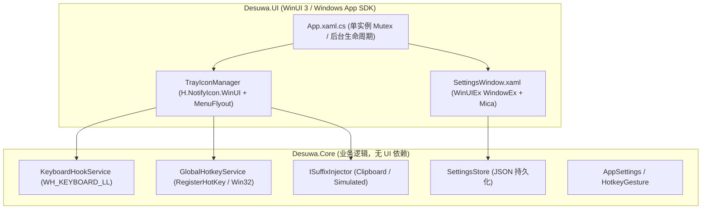

# Desuwa v3.0.0 架构升级与 Fluent UI 全面改造规划

> **目标版本**：`v3.0.0`  
> **核心目标**：从 WinForms 全面升级至 **WinUI 3 (Windows App SDK) + Fluent UI**，实现 Windows 11 原生级视觉体验（包括托盘右键菜单和设置界面），同时保持极简后台常驻与高可靠文本注入能力。

---

## 1. 现状剖析与架构选型对比

### 1.1 现状与痛点（v2.0.3 - WinForms）
- **UI 风格老旧**：WinForms 的 `ContextMenuStrip` 和 `Form` 为传统 Win32 样式，在高分辨率/Win11 下即使强开深色模式也缺少圆角阴影、亚克力半透明和流畅微动画。
- **与 WinForms 紧耦合**：热键枚举（`System.Windows.Forms.Keys`）、剪贴板访问、消息循环均与 `System.Windows.Forms` 深度绑定。

### 1.2 现代化方案对比

| 维度 | 方案 A：WinUI 3 (推荐) | 方案 B：WPF + Wpf.Ui | 方案 C：WinForms 魔改 |
| :--- | :--- | :--- | :--- |
| **参考项目** | `Ori-WotW-QoE-Mod` / `OpenHardwareMonitorWinUI` | 一般 XAML 桌面工具 | 当前 Desuwa 仓库 |
| **托盘菜单 Fluent 度** | ⭐️⭐️⭐️⭐️⭐️ (原生 `MenuFlyout`，亚克力/圆角/流体动画) | ⭐️⭐️⭐️ (WPF 自绘模拟) | ⭐️ (仅 Win32 灰色方框) |
| **主窗口 Fluent 度** | ⭐️⭐️⭐️⭐️⭐️ (原生 Mica 云母、Win11 标准控件) | ⭐️⭐️⭐️⭐️ (仿 Win11 控件) | ⭐️⭐️ (传统 WinForms 控件) |
| **单文件 / 绿色分发** | 目录 Zip 或 SFX（因 MRT Core/PRI 机制） | 单文件 exe 友好 | 单文件 exe 极小 |
| **系统兼容性** | Windows 10 (1809+) & Windows 11 | Windows 7+ | Windows 7+ |

> [!NOTE]  
> 经调查发现，`PowerToys` 的托盘大多仍使用传统 Win32 `TrackPopupMenuEx`（非现代 Fluent UI），而 **`Ori-WotW-QoE-Mod`** 采用的 **`H.NotifyIcon.WinUI` + `MenuFlyout`** 则是当前在 Win11 下实现**真·Fluent UI 托盘右键菜单**的最佳范例。

---

## 2. 目标架构设计

重构后的项目将分为清晰的两层：**Core（无 UI 业务内核）** 与 **UI（WinUI 3 表现层）**。



### 2.1 核心解耦（Core Layer）
1. **脱离 WinForms 依赖**：
   - 将 `Keys` 枚举改为平台中立的虚拟键枚举 `VirtualKey`（或直接使用 `Windows.System.VirtualKey`），确保字符串序列化（如 `"F10"`, `"Alt"`）与原 `settings.json` 完全兼容。
   - 剪贴板注入器切换为 Win32 / WinRT 剪贴板 API。
2. **消息循环解耦**：
   - 钩子与热键原本依赖 WinForms 隐藏窗体 `MessageWindow : Form`，改用轻量级原生 Win32 消息窗口（`NativeMethods.CreateWindowEx`）或 WinUI Dispatcher 处理。

### 2.2 表现层（UI Layer）
1. **系统托盘与 MenuFlyout**：
   - 使用 `H.NotifyIcon.WinUI` 托管托盘图标。
   - 右键弹出真正的 `MenuFlyout`，包含：
     - 开关切换（带 Check 图标/状态显示）
     - 输入模式单选（剪贴板模式 / 逐字模拟模式）
     - 打开设置...（Segoe Fluent 图标 `\uE713`）
     - 分隔线
     - 退出（Segoe Fluent 图标 `\uE711`）
2. **Win11 设置面板（`SettingsWindow.xaml`）**：
   - 继承自 `WinUIEx.WindowEx`，开启 **Mica（云母）** 背景材质。
   - 使用 Win11 卡片式设置布局（`SettingsExpander` / `SettingsCard`）：
     - **口癖设置卡片**：文本输入框 + 快捷标签 + 默认恢复按钮。
     - **输入模式卡片**：单选切换与兼容性说明。
     - **全局快捷键卡片**：快捷键录制控件、按键冲突实时校验。
   - 深色/浅色模式跟随系统主题自动无缝切换。

---

## 3. 构建、缓存与发布规范（遵循 AGENTS.md）

### 3.1 临时文件与构建缓存约束
- **临时构建目录**：遇到实验性脚本或本地验证产物，统一存放在 `D:\temp\gemini\Desuwa`。
- **仓库内临时构建**：利用仓库中已被 `.gitignore` 的文件夹（如 `publish/`, `artifacts/`, `bin/`, `obj/`）。
- **清理约束**：任务完成后提醒用户删除临时目录，待用户明确确认后再行清理。
- **红线**：严禁触碰 `D:\TMP`（用户素材区）；不往 `C:` 盘或 `D:\cache` 放置项目专有产物。
- **网络代理**：拉取 NuGet 依赖时按需使用 `$Env:HTTP_PROXY = "http://127.0.0.1:7890"`。

### 3.2 WinUI 3 项目配置（.csproj）
参考 `Ori-WotW-QoE-Mod` 的配置标准：
```xml
<Project Sdk="Microsoft.NET.Sdk">
  <PropertyGroup>
    <OutputType>WinExe</OutputType>
    <TargetFramework>net8.0-windows10.0.19041.0</TargetFramework>
    <TargetPlatformMinVersion>10.0.19041.0</TargetPlatformMinVersion>
    <UseWinUI>true</UseWinUI>
    <WindowsPackageType>None</WindowsPackageType>
    <WindowsAppSDKSelfContained>true</WindowsAppSDKSelfContained>
    <RuntimeIdentifier>win-x64</RuntimeIdentifier>
    <Platforms>x64</Platforms>
    <ImplicitUsings>enable</ImplicitUsings>
    <Nullable>enable</Nullable>
    <AllowUnsafeBlocks>true</AllowUnsafeBlocks>

    <!-- 升级版本号至 3.0.0 -->
    <Version>3.0.0</Version>
    <AssemblyVersion>3.0.0.0</AssemblyVersion>
    <FileVersion>3.0.0.0</FileVersion>

    <ApplicationIcon>Assets\app.ico</ApplicationIcon>
    <PublishSingleFile>false</PublishSingleFile>
    <PublishTrimmed>false</PublishTrimmed>
    <SelfContained>true</SelfContained>
  </PropertyGroup>

  <ItemGroup>
    <PackageReference Include="Microsoft.WindowsAppSDK" Version="1.6.*" />
    <PackageReference Include="H.NotifyIcon.WinUI" Version="2.4.1" />
    <PackageReference Include="WinUIEx" Version="2.5.*" />
    <PackageReference Include="CommunityToolkit.Mvvm" Version="8.4.0" />
  </ItemGroup>

  <!-- 确保发布输出包含 MRT Core PRI 资源，避免启动丢失资源报错 -->
  <Target Name="CopyProjectPriToPublish" AfterTargets="Publish" Condition="Exists('$(TargetDir)$(TargetName).pri')">
    <Copy SourceFiles="$(TargetDir)$(TargetName).pri" DestinationFolder="$(PublishDir)" />
  </Target>
</Project>
```

---

## 4. GitHub Actions CI/CD 复现与发布重构

在 `.github/workflows/build.yml` 中：
1. **Runner 环境**：采用 `windows-latest`，配合 `actions/setup-dotnet@v5`（.NET 8.0 SDK）。
2. **三套分发版构建规划**：
   - **📦 Self-contained（免运行环境版）**：`dotnet publish -c Release -r win-x64 --self-contained true`，将发布文件夹归档为 `Desuwa-windows-x64-self-contained-v3.0.0.zip`。
   - **🧩 Runtime-dependent（轻量版）**：`dotnet publish -c Release -r win-x64 --self-contained false`，归档为 `Desuwa-windows-x64-runtime-dependent-v3.0.0.zip`。
   - **🐛 Debug（调试版）**：包含完整 PDB 符号文件的 zip 包。
3. **自动化 Release**：保留现有通过 commit message 触发自动发布（`build release`）与模板生成 release notes 的机制。

---

## 5. 分步实施执行清单（Roadmap）

- [ ] **Phase 1: 基础工程与版本升级**
  - 版本号 bump 到 `3.0.0`（更新 `Desuwa.csproj` 与相关文档）。
  - 清理/移除 WinForms 依赖（`<UseWindowsForms>false</UseWindowsForms>`）。
  - 引入 WinUI 3 / WindowsAppSDK / H.NotifyIcon.WinUI / WinUIEx。
- [ ] **Phase 2: 核心层逻辑解耦**
  - 将热键与配置的按键枚举与 WinForms 分离，确保兼容已有 `settings.json`。
  - 迁移底层键盘钩子与 Win32 消息泵。
- [ ] **Phase 3: 托盘与 Win11 Fluent MenuFlyout**
  - 实现无主窗体后台常驻（托盘即入口）。
  - 编写 XAML `MenuFlyout` 替代原 `ContextMenuStrip`。
  - 托盘图标动态切换（启用态 / 禁用态）。
- [ ] **Phase 4: Mica 现代设置窗口**
  - 实现 WinUI 3 卡片式设置界面。
  - 支持快捷键录制、口癖配置、即时保存与热加载。
- [ ] **Phase 5: 打包、CI 构建复现与验证**
  - 更新 `.github/workflows/build.yml` 构建步骤与产物压缩逻辑。
  - 本地在 `D:\temp\gemini\Desuwa` 验证多配置发布，并提醒用户确认清理。
